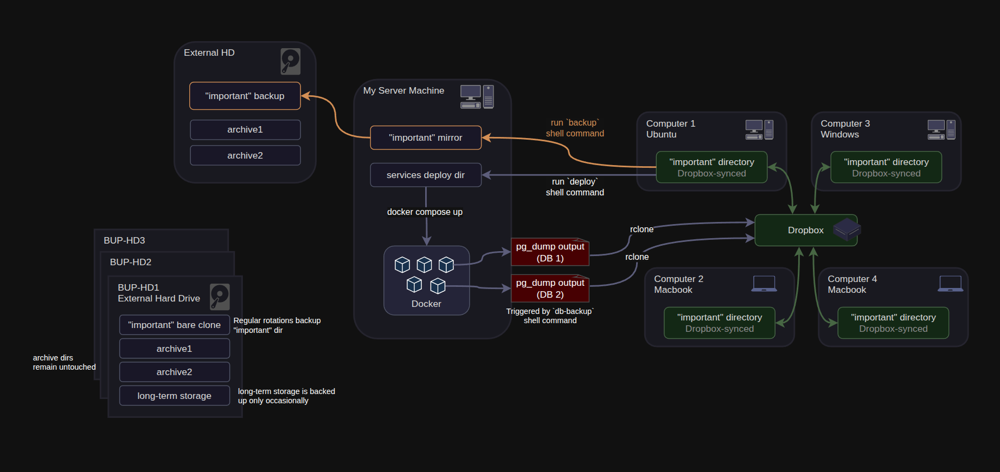
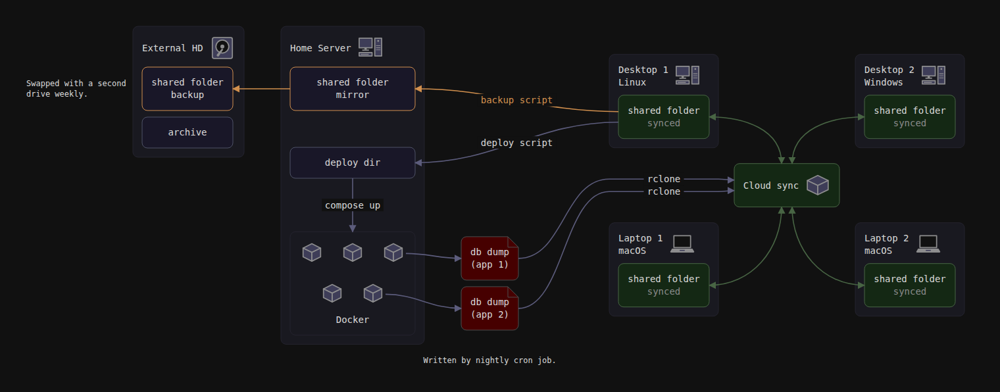
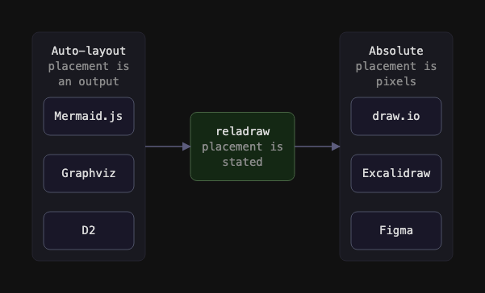

# reladraw

<a href="https://news.ycombinator.com/item?id=49858513"></a>

reladraw is a text language for diagrams where you say where things go.

> The language is changing frequently. The playground always runs the newest syntax, so a diagram that draws there today may need a small edit later. An installed copy from npm changes only when you upgrade it.

**[Try it in your browser in the reladraw playground →](https://reladraw.github.io/reladraw/)**

I wanted to be able to create custom, expressive diagrams where I decided how to arrange the diagram, but without the inefficiency of manually drawing in draw.io. For example, this is a diagram drawn in draw.io:



This is the same diagram, but written in reladraw ([`examples/arch.reladraw`](examples/arch.reladraw)).



## Why not Mermaid or draw.io?

Mermaid, Graphviz and D2 let you declare boxes and connections, then determine positions for you. If you have a particular picture in mind, these aren't the right tool.

On the other hand, tools like draw.io or Excalidraw allow absolute placement, but that means much more effort, whether for humans clicking and dragging nodes around or agents recalculating coordinates and editing verbose XML source code files.



reladraw sits between those two extremes, aiming to have the benefits of a diagram language, like Mermaid, but also having the expressiveness and custom placement that you can get with draw.io. Positions are relative, so you don't have to manually pick coordinates. For example:

```
node app "Web app"
node app.ui  "Interface"
node app.api "API"  below app.ui (gap: tight)

node store "Database"  right of app (gap: 12)  even with app.api

edge app.api -> store  "queries"
```

The tool draws what the file says and nothing else: a gap is the gap you wrote, and a line is straight unless you say how it bends or where it passes. It never moves a box to make room or routes a line round one. Where the picture may not read as you meant, such as a line crossing a box or two texts on top of each other, it draws it anyway and prints a one-line warning saying where and by how much, so you or your agent can fix the source.

See also [SYNTAX.md](SYNTAX.md) and [examples/](examples/).

## Install

```
npm install -g reladraw
reladraw render diagram.reladraw -o diagram.svg
```

`reladraw check diagram.reladraw` prints the warnings without writing a picture, and `reladraw format diagram.reladraw` lines its statements up in columns. `reladraw render diagram.reladraw --page` writes a page for looking at it in a browser, with pan, zoom, full screen and the warnings beside it.

Or from a clone, which also gets you the examples:

```
npm install && npm run build
node dist/cli.js render examples/arch.reladraw -o out.svg
```

## In a web page

Load one script, then write diagrams straight into the page:

```html
<script type="module" src="https://cdn.jsdelivr.net/npm/reladraw/dist/element.js"></script>

<reladraw-diagram>
  node a "Parser"
  node b "Renderer" right of a
  edge a -> b
</reladraw-diagram>
```

Each `<reladraw-diagram>` is replaced by its SVG. Indent the source however suits the page, since the indentation its lines share is taken off. Add `theme="light"` (or any other theme) to change the colors. A mistake is shown where the diagram would have been, with its line number counted from the first line of the diagram. The page's HTML is read first, so a `<` followed by a letter inside a text has to be written `&lt;`.

## Using it with an agent

To install a skill to let your agent know how to use reladraw:

```
reladraw install-skill -g
```

That installs the skill that came with your copy of reladraw, so it teaches what your reladraw accepts, for every agent you use (Claude Code, Codex, Cursor, Copilot and others), each in its own skills directory. It hands the work to [skills](https://www.npmjs.com/package/skills), and passes on whatever you write after `install-skill`. Leave off `-g` to install it into the current project only. To install it for just one agent, name it with `-a`:

```
reladraw install-skill -g -a claude-code
```

The skill is a copy, so after upgrading reladraw, run the command again to bring the skill up to date with it.

To install the skill from the main branch instead, which can run ahead of the release on npm, run `npx skills add reladraw/reladraw -g`.

## Status

Version 0.23.1. Early stage, but works. The parser, layout engine, and SVG renderer are written in TypeScript, with zero runtime dependencies. There is a command-line tool that turns a .reladraw text file into an SVG, and an element that does the same inside a web page.

## License

Apache-2.0. See [LICENSE](LICENSE). The license covers the code, not the name. It grants no rights to "reladraw", the project logo or the project's other marks. See [NOTICE](NOTICE).

## Contributing

Issues are welcome. Particularly helpful is a diagram you could not represent in reladraw. Pull requests are not accepted; please open an issue instead. See [CONTRIBUTING.md](CONTRIBUTING.md).
